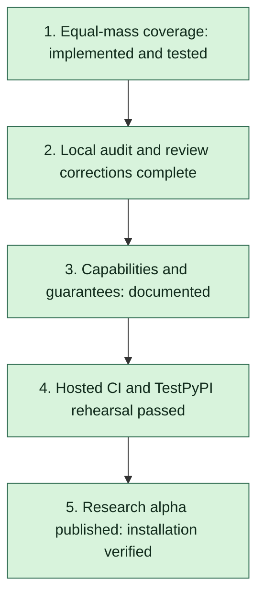

# Research-alpha release plan — completed for 0.3.0a4

Work proceeds in this order. A completed implementation is distinct from
independent scientific review and from publication.

| Order | Objective | Completion criteria | Status |
|---|---|---|---|
| 1 | Close the equal-mass Euclidean gap | Derived convergent series, documented normalization and tail bound; vacuum, quadrature and overlap checks; bounded work | Implemented; validation recorded below |
| 2 | Audit the numerical backend | Reproducible benchmark grid, independent references, actual versus reported errors, boundary and budget failures, review packet | Local audit passed; supplementary review corrections complete; human peer review welcome |
| 3 | Make capabilities explicit | One capability table; distinguish RMT, analytic continuation and numerical integration; describe all error guarantees | Implemented |
| 4 | Gate publication on validation | Release-commit tests, wheel and source-distribution checks outside checkout, platform smoke tests, TestPyPI rehearsal workflow | Final candidate passed hosted validation, TestPyPI rehearsal and production upload/install |
| 5 | Prepare the public research alpha | Runnable notebook, versioned release notes, citation/contribution instructions and release checklist | 0.3.0a4 published to PyPI; fresh installation and artifact hashes verified |

The supplementary review and all six corrections are recorded in
{doc}`SCIENTIFIC_REVIEW`; no human peer review is claimed. Version 0.3.0a3
restored TestPyPI availability. Version **[0.3.0a4](https://pypi.org/project/ramanujan-qft/0.3.0a4/)**
was published on 2026-10-24 after the corrected candidate passed its
[TestPyPI rehearsal](https://github.com/reetanshuh1998/Ramanujan_master_theorem/actions/runs/40056460397)
and [production workflow](https://github.com/reetanshuh1998/Ramanujan_master_theorem/actions/runs/40057042071).
The completed checklist and artifact evidence are in {doc}`RELEASING`.
Version 0.3.0a5 prepares an author-metadata and documentation correction;
it changes no numerical algorithms and follows the same release checks.

## Scope

The first release targets a credible, reproducible research tool. General
topology-specific convergence selection, epsilon expansions, overlapping
subtractions, massless integrals and physical-region continuation remain later
research objectives.

## Historical implementation evidence

The entries below describe earlier milestones; the completed release status is above.

- Initial state: graph-derived RMT sunset charts require momentum dominance or
  mass dominance. Equal-mass vacuum is explicitly refused.
- The initial release workflow built and published without a validation
  dependency; CI ran only on Linux.
- Objective 1: added a separately named equal-mass Taylor backend. Its
  transformed parameter-integral series converges for every finite Euclidean
  momentum, subject to work budgets. It is not presented as a new RMT family.
  The derivation includes a tail bound and the recurrence's precision hazard.
- Objective 1: all 15 dedicated tests passed, including independent parameter
  quadrature and overlap with the generated RMT series.
- Objective 2: the fixed-seed audit passed all cases after resolving an
  inadequate-reference-precision finding. Source hashes and individual results
  are in `benchmarks/data/sunset_audit.json`. The subsequent review and
  corrections are recorded in [the review packet](SCIENTIFIC_REVIEW.md).
- Objective 3: [the capability table](CAPABILITIES.md) describes each method,
  accepted domain and error contract, including the unequal-mass gap.
- Objective 4: publication now depends on a reusable validation workflow:
  tests, audit, documentation and isolated wheel/sdist checks on Linux, Windows
  and macOS. A manual-only TestPyPI rehearsal workflow is prepared.
- Full local regression suite: 440 tests passed, including the slow quadrature
  checks; one existing SciPy reference-quadrature roundoff warning was emitted.
- Final local checks: 19 doctests, all six research-notebook code cells, all 67
  documentation examples, a warning-free Sphinx build with the rendered
  plan chart, actionlint and strict distribution metadata checks passed.
- The 0.3.0a1 wheel and source distribution installed successfully into fresh
  environments outside the checkout. Both numerical series APIs passed with
  SciPy unavailable. The source archive contains the reproduction material.
- The initial candidate included a notebook, citation metadata, contribution
  guide and draft release notes. Review and publication were still pending
  at that milestone; their completion is recorded above.
- Hosted validation for candidate `b224380` passed: [tests, audit and six
  platform/artifact combinations](https://github.com/reetanshuh1998/Ramanujan_master_theorem/actions/runs/39865347949)
  and [full documentation/gallery checks](https://github.com/reetanshuh1998/Ramanujan_master_theorem/actions/runs/39865347891).
  Subsequent changes must pass CI again; current results are tracked in
  [merged PR #3](https://github.com/reetanshuh1998/Ramanujan_master_theorem/pull/3)
  and the main-branch workflow runs.
- Candidate `3b00bd6` passed the [TestPyPI rehearsal](https://github.com/reetanshuh1998/Ramanujan_master_theorem/actions/runs/39924746748):
  validation, trusted-publisher upload and fresh installation from the index.
  Published wheel/source hashes matched the validated artifacts. Later changes
  require another frozen candidate and an unused version for a repeat upload.
