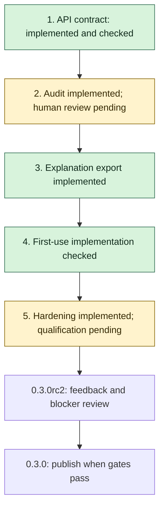

# Plan for the first stable release

Target: stable **0.3.0**. Beta **0.3.0b5** packages the implemented engineering
work from all five objectives, including the corrections rehearsed as rc2.
Human scientific review and outside-user/hosted-Colab feedback remain pending.
This beta does not promote experimental calculations to stable status.

The goal is a reproducible, documented interface for the calculations already
supported in {doc}`CAPABILITIES`. Unequal-mass sunset continuation, new
topologies, regulator expansions and physical-region series remain separate
research milestones.

## Order and progress

| Order | Objective | Status | Evidence required to finish |
|---|---|---|---|
| 1 | Define the stable API | Implemented; validation recorded below | Compatibility policy, classified interfaces, naming clarification, executable contract checks |
| 2 | Strengthen scientific validation | Automated audit passed; human review pending | Reproducible boundary/error audit, independent references, review disposition |
| 3 | Make the RMT calculation inspectable | Implemented; validation recorded below | Versioned explanation/export format, exact graph-to-series trace, reference checks |
| 4 | Improve first-use experience | Local/browser/notebook checks passed; interactive Colab pending | Method-selection guide, actionable errors, three executed end-to-end examples |
| 5 | Harden release automation | Implemented; full qualification pending | Bounded index retry, dependency and upgrade checks, frozen candidate evidence |

Finish and record each implementation milestone before starting the next.
Keep human review requests distinct from completed reviews. Review can proceed
while later engineering work continues; unresolved scientific blockers stop
promotion of the affected API. Record a partial result or a failed check as
such, rather than marking an objective complete.

## 1. Define and test the API contract

Deliverables:

- [x] List the interfaces targeted for stability, experimental interfaces and
  retained legacy interfaces in {doc}`API_STABILITY`.
- [x] Specify import paths, arguments, numerical conventions, return shapes,
  diagnostic meanings and exception handling.
- [x] Define compatible changes, deprecation notices and exceptions for
  correctness fixes. Keep existing callers working.
- [x] Add `sunset_second_derivative` as a clearer spelling of `sunset_d2`.
  Both names continue to mean the second derivative of the four-dimensional
  dispersive sunset, never the D=2 graph integral.
- [x] Add executable compatibility checks and verify the new spelling against
  an independent reference and the existing numerical regressions.

Completion: the contract and implementation agree, existing imports and calls
still work, and relevant tests plus documentation builds pass. This completes
interface preparation; scientific promotion still depends on objective 2.

## 2. Strengthen scientific validation

Use {doc}`CLAUDE_REVIEW_BRIEF` to request an additional automated review of the
frozen development packet. It supplies the prompt, checks and report format;
its results do not replace the human-review gate below.

Build on `tools/audit_sunset.py`, its 34-case baseline and the existing regression
fixtures. Avoid replacing earlier evidence or presenting repeated checks as new
independent methods.

- [x] Define an exact-input grid for both RMT charts, chart boundaries, equal
  and unequal masses, colliding poles, extreme scales and work/precision limits.
- [x] Compare accepted values with independent references at sufficient extra
  precision. Record absolute error, relative error when meaningful, reference
  uncertainty, reported error and whether the requested tolerance was met.
- [x] Separate accepted evaluations, expected domain refusals, budget refusals
  and unresolved references. An unresolved reference cannot count as a pass.
- [x] Audit hybrid estimates across a declared graph grid and multiple fixed
  random seeds. Report error-estimate coverage and outliers; do not turn an
  empirical coverage fraction into a universal confidence guarantee.
- [x] Include mass permutations, scaling identities and agreement in overlapping
  domains as additional checks, with their dependence on shared formulas stated.
- [ ] Obtain a human review of the prepared frozen packet by a qualified reviewer covering normalization, convergence,
  collision limits and error estimates. Record
  findings and dispositions; retain the existing automated review unchanged.

Completion: no unexplained discrepancies in the declared grid; reference and
budget failures are visible; review status is explicit. A human review may only
be marked complete when an actual reviewer report is available. Findings can
keep an API experimental without preventing release of other qualified APIs.

## 3. Explain and export the RMT calculation

Build on `compile_sunset_rmt`, `ScalarGraph.symanzik` and `schwinger_brackets`.
Decide the public explanation API after the contract and audit are in place.

- [x] Produce a structured trace containing input conventions, exact U/F
  polynomials, exponent matrix and offsets, selected families, Gamma terms,
  regulator/pole limit and the resolved coefficient expression.
- [x] Include chart-selection conditions and exact convergence bounds. Label
  a formal bracket solution separately from a justified evaluable series.
- [x] Attach optional evaluation diagnostics: value, requested and working
  precision, terms, tail bound and arithmetic estimates.
- [x] Export a versioned JSON schema with exact symbolic/decimal strings,
  package/source provenance and documented encoding. Never deserialize exported
  expressions through unrestricted `eval`.
- [x] Test both RMT charts, pole collisions, unsupported inputs, export precision
  and the relationship between the exported trace and evaluated series.

Completion: a user can reproduce a supported graph-to-series calculation from
an example and inspect why its selected chart is valid. The trace must not
imply that matrix invertibility proves convergence or that a numerical error
estimate is a rigorous enclosure.

## 4. Improve the first calculation experience

- [x] Add a decision guide based on topology, dimension, masses, momentum and
  requested precision. Explain each method without silently switching backends.
- [x] Make domain/budget errors describe the failed condition, relevant inputs
  and useful next action; preserve exception types from objective 1.
- [x] Provide three complete examples: a scalar one-loop integral, a D=2 sunset
  RMT series and a hybrid multiloop graph. Each states normalization, reports
  diagnostics and compares with an independent reference.
- [x] Link the RMT explanation/export from the sunset example. Demonstrate a
  useful domain or budget refusal as well as a successful evaluation.
- [x] Run the examples locally, in the documentation, in the browser and through
  the notebook calculation checker. Label optional SciPy requirements accurately.
- [ ] Confirm the development notebook in an interactive hosted Colab session;
  local/CI notebook execution is recorded separately.

Completion: installation-to-reference comparison is reproducible from each
example, and a new user can identify supported methods and their limitations.

## 5. Harden releases and qualify the candidate

- [x] Add bounded retries for a newly uploaded version becoming visible in the
  selected index. Test the observed missing-version case, eventual success and
  exhaustion. Preserve genuine install/smoke failures and never reupload files.
- [x] Exercise supported dependency minima and current dependencies on suitable
  Python versions. Document the tested combinations; do not promise untested
  combinations of old dependencies and new interpreters.
- [x] Test a clean installation and an upgrade from 0.3.0a5 outside the checkout,
  including optional dependencies and legacy imports.
- [x] Run the complete test, audit, documentation, browser and platform/artifact
  checks on the frozen 0.3.0rc2 candidate. Rehearse on TestPyPI and verify hashes.
- [ ] Collect feedback from users on their own integrals; record inputs,
  conventions, results and any unresolved blockers.
- [ ] Update the version, citation, development-status classifier and release
  notes consistently. Validate the final 0.3.0 artifacts, publish them and verify
  installation from production PyPI.

Completion: all selected stable interfaces meet their documented contract and
validation criteria; final release checks pass; no known scientific blocker is
hidden by a version change. Experimental interfaces remain explicitly labeled.

## Working notes and evidence

Baseline: 0.3.0a5 passed 455 tests, documentation/browser checks and release
artifact validation. Its publication record is in {doc}`RELEASING`.
Both initial index-install attempts preceded visibility of the new version;
rerunning the install jobs succeeded. Objective 5 addresses that observed race.

Record completed work here with paths, commands, outcomes and remaining limits.
Keep generated development runs outside tracked source unless deliberately
retained as reproducible release evidence. Do not overwrite the 0.3.0a5 reports.

### Objective 1 implementation

- `docs/API_STABILITY.md` defines the proposed contract, classification,
  conventions, result attributes, error handling and deprecation policy.
- `sunset_second_derivative` is exported from the package and sunset module;
  `sunset_d2` retains its existing behavior. No numerical kernel was changed.
- `tests/data/public_api_contract.json` records 25 callable signatures and
  required diagnostics. `tests/test_api_contract.py` adds 34 compatibility
  checks, including the independent identity S''(0; 0, 0, M) = -1/(6M),
  where M is the squared mass. Do not regenerate the baseline merely to
  accommodate an incompatible change.
- Local validation: 464 fast tests passed; the new slow derivative-reference
  test passed; 19 docstring examples passed. The development suite collects
  489 tests (25 slow). All 67 documentation blocks and a warnings-as-errors
  Sphinx build passed. The other 24 slow reference tests are part of hosted CI.
- The new interfaces and notes are unreleased development work. Stable
  promotion remains contingent on the later objectives.

### Objective 2 implementation

- `tools/audit_stability.py`: 25 series cases (15 values, four domain refusals,
  six budget refusals), eight invariant comparisons, and 32 hybrid samples
  across eight fixed seeds. All passed at 15 requested digits for the series;
  all 32 hybrid samples were covered by their reported errors on this grid.
- Ten audit/packet regression checks passed, including unresolved references,
  underestimated errors, zero references and stale source rejection.
- `tools/prepare_review_packet.py` freezes source, tests, report and hashes.
  Packet prepared at `/home/reet/ramanujan-stable-objective2-review` on 2026-10-25.
  It is an objective-2 snapshot, not the eventual final release candidate.
- See {doc}`STABILITY_AUDIT` for reproduction and statistical limitations.
  Human review remains pending; no human assessment has been fabricated.

### Objective 3 implementation

- `explain_sunset_rmt` exports the exact compiler trace and optional evaluation
  diagnostics. Budget failures retain an explicit status and partial diagnostics;
  unsupported domains still raise typed exceptions without fallback.
- A bundled draft-2020-12 JSON Schema defines provisional format version 1.
  Binary mantissa/exponent fields preserve mpmath values exactly; symbolic strings
  are descriptive and are never evaluated when reading an export.
- Ten export tests passed: both charts, mass vacuum, matrix constraints, graph
  reconstruction, provenance, 60-digit round-trip at low global precision,
  schema validation and typed domain/budget failures.
- See {doc}`user_guide/explanation` for the runnable graph-to-series example.

### Objective 4 implementation

- {doc}`getting_started/choose_method` maps graph, dimension, kinematics and
  precision to explicit methods. Domain errors now include exact inputs and
  alternatives; precision-budget errors name the adjustable limit.
- `examples/08_first_calculations.py` passed three independent reference checks:
  one-loop Feynman parameters, the frozen sunset simplex fixture and a D=1
  three-loop Fourier formula. Each states its normalization and diagnostics.
- The same calculation code is embedded in the development notebook and browser
  console. A regression check prevents copies drifting. Notebook cells passed
  locally; the network installation cell is checked separately through artifacts.
- Thirteen walkthrough/export tests and the warnings-as-errors Sphinx build
  passed. All 70 documentation blocks and all eleven real-browser examples
  passed, including reference assertions, reset and custom dependency wheels.
- An interactive Colab session remains a user check; the notebook is not claimed
  to have been run on Google's hosted service by this development run.

### Objective 5 implementation

- `tools/install_from_index.py` retries only the selected index's exact
  missing-version response. Fourteen policy tests passed, including eventual
  visibility, exhaustion, other-package failures, connection warnings and timeout.
- The workflow adds a pinned Python 3.9 minimum-dependency job, the stability
  audit, shared notebook/examples, and baseline-to-artifact upgrades with and
  without the optional SciPy extra. Existing Node.js 24 actions are retained.
- Wheel/sdist smoke checks now verify legacy imports and bundled explanation
  schema. Upgrade checks assert the installed baseline and target versions.
- Version, citation and package metadata identify development 0.3.0rc1.dev1.
  This is not the frozen 0.3.0rc1 candidate and has not been published.
- Full tests, artifact installs/upgrades, source-bound audits and hosted checks
  are tracked in [PR #10](https://github.com/reetanshuh1998/Ramanujan_master_theorem/pull/10).
  The development suite now contains 527 tests, including 25 slow checks.
- The expanded audit passed again on 0.3.0rc1.dev1 (all 25 series cases, eight
  invariants and 32 hybrid samples); the original 34-case audit also passed.
  Nineteen docstring examples, strict Twine metadata and actionlint checks passed.
- Local source-archive installation and upgrades from 0.3.0a5 with/without SciPy
  passed outside the checkout. Hosted minimum-dependency, Python 3.9/3.11,
  six platform/artifact jobs, both upgrades, audits and documentation/browser
  jobs passed on implementation commit `3fed46f`. The full slow suite and the
  subsequent packet-completeness regression are recorded in PR checks.
- The packet builder now includes examples, notebooks and browser source;
  a regression checks that copied walkthroughs agree and every manifest hash
  matches. Eleven audit/packet regression tests passed.
- A fresh development review snapshot is prepared at
  `/home/reet/ramanujan-stable-development-review`. It binds this numerical
  implementation and its audit, not a frozen or externally approved candidate.

Remaining external gates: qualified human scientific review, interactive Colab
and outside-user feedback, then frozen-candidate TestPyPI rehearsal and final
release qualification. The engineering changes do not mark these gates complete.

### Supplementary Claude review

The development-snapshot report has been received and its artifact hashes
verified. It requests changes; see {doc}`REVIEW_DISPOSITION` for R1–R7 and the
remaining qualification questions. The old packet remains intact. In particular,
the previous packet-completeness claim was too broad: benchmark modules were
missing and full collection failed. The replacement regression collects tests
inside the packet rather than checking only shared examples and manifest hashes.

Schema-v2 audits separate hybrid accuracy from empirical coverage and retain
exact binary values. A coverage alert remains a review item, even when requested
accuracy is met. The hybrid API remains experimental.

### Corrected candidate 0.3.0rc1

R1–R7 dispositions are recorded in {doc}`REVIEW_DISPOSITION`. The candidate
pins the walkthrough installation to `v0.3.0rc1`; version, citation and release
metadata agree. Stable publication remains conditional on the outstanding
qualification decisions. The corrected candidate's tests, packet reproduction
and TestPyPI results will be recorded with its frozen commit and artifact hashes.

Candidate rc1 was frozen before an additional source-archive support-file gap
was found. Its TestPyPI rehearsal was stopped before upload. Candidate rc2
includes the root review-support files and workflow definitions, with an
artifact-content check in the build job. The rc1 tag is retained unchanged.

### Candidate rehearsal completed; external gates retained

Tag `v0.3.0rc2`, commit `e44085bd363248a46223ddb4afd9e28aada49278`, passed
[TestPyPI rehearsal and index installation](https://github.com/reetanshuh1998/Ramanujan_master_theorem/actions/runs/40193319458).
The complete candidate validation and documentation/browser jobs passed.
Both published artifacts were downloaded and their bytes matched the validated
workflow SHA-256 hashes; see {doc}`RELEASING` for the binding record.

The full suite from an isolated copy of the corrected rc1 packet passed 537
tests, with the known SciPy reference-quadrature roundoff warning. The rc2
archive adds one guard regression; hosted candidate validation covers the
538-test suite. Twenty review-tool tests also passed directly from an extracted
pre-freeze rc2 source archive, confirming the reproduction support files.

The rc2 extended audit (seeds 1000–1031) met all 128 hybrid accuracy targets,
with 125/128 error estimates covering the reference difference. All three
misses remain explicit coverage alerts; the hybrid API remains experimental.

The maintainer chose to **keep** qualified-human scientific review and
outside-user/interactive-Colab feedback as gates. These remain pending. No
production stable release was created; PyPI remains at 0.3.0a5. The next action
is review and feedback on `/home/reet/ramanujan-qft-0.3.0rc2-review`, not another
unfrozen upload or an automatic promotion from green CI.

### Beta 0.3.0b5 publication

The maintainer requested a production PyPI **prerelease**, 0.3.0b5, containing
all five implemented engineering objectives. This authorizes beta publication,
while retaining the external gates for stable 0.3.0. Mathematical domains and
numerical algorithms are unchanged from the validated rc2 candidate.
Version metadata, citation, installation examples and the walkthrough tag now
identify b5. The beta's own frozen-tag validation, TestPyPI rehearsal and
production verification are recorded in {doc}`RELEASING`.
