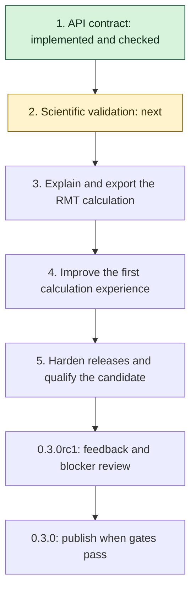

# Plan for the first stable release

Target: **0.3.0**, following a tested **0.3.0rc1** candidate. The published
baseline is 0.3.0a5. This page tracks development; it does not announce a new
release or promote experimental calculations to stable status.

The goal is a reproducible, documented interface for the calculations already
supported in {doc}`CAPABILITIES`. Unequal-mass sunset continuation, new
topologies, regulator expansions and physical-region series remain separate
research milestones.

## Order and progress

| Order | Objective | Status | Evidence required to finish |
|---|---|---|---|
| 1 | Define the stable API | Implemented; validation recorded below | Compatibility policy, classified interfaces, naming clarification, executable contract checks |
| 2 | Strengthen scientific validation | Planned | Reproducible boundary/error audit, independent references, review disposition |
| 3 | Make the RMT calculation inspectable | Planned | Versioned explanation/export format, exact graph-to-series trace, reference checks |
| 4 | Improve first-use experience | Planned | Method-selection guide, actionable errors, three executed end-to-end examples |
| 5 | Harden release automation | Planned | Bounded index retry, dependency and upgrade checks, frozen candidate evidence |

Finish and record each implementation milestone before starting the next.
Keep human review requests distinct from completed reviews. Review can proceed
while later engineering work continues; unresolved scientific blockers stop
promotion of the affected API. Record a partial result or a failed check as
such, rather than marking an objective complete.

## 1. Define and test the API contract

Deliverables:

- [x] List the interfaces targeted for stability, experimental interfaces and
  retained legacy interfaces in {doc}`API_STABILITY`.
- [x] Specify import paths, arguments, numerical conventions, return shapes,
  diagnostic meanings and exception handling.
- [x] Define compatible changes, deprecation notices and exceptions for
  correctness fixes. Keep existing callers working.
- [x] Add `sunset_second_derivative` as a clearer spelling of `sunset_d2`.
  Both names continue to mean the second derivative of the four-dimensional
  dispersive sunset, never the D=2 graph integral.
- [x] Add executable compatibility checks and verify the new spelling against
  an independent reference and the existing numerical regressions.

Completion: the contract and implementation agree, existing imports and calls
still work, and relevant tests plus documentation builds pass. This completes
interface preparation; scientific promotion still depends on objective 2.

## 2. Strengthen scientific validation

Build on `tools/audit_sunset.py`, its 34-case baseline and the existing regression
fixtures. Avoid replacing earlier evidence or presenting repeated checks as new
independent methods.

- [ ] Define an exact-input grid for both RMT charts, chart boundaries, equal
  and unequal masses, colliding poles, extreme scales and work/precision limits.
- [ ] Compare accepted values with independent references at sufficient extra
  precision. Record absolute error, relative error when meaningful, reference
  uncertainty, reported error and whether the requested tolerance was met.
- [ ] Separate accepted evaluations, expected domain refusals, budget refusals
  and unresolved references. An unresolved reference cannot count as a pass.
- [ ] Audit hybrid estimates across a declared graph grid and multiple fixed
  random seeds. Report error-estimate coverage and outliers; do not turn an
  empirical coverage fraction into a universal confidence guarantee.
- [ ] Include mass permutations, scaling identities and agreement in overlapping
  domains as additional checks, with their dependence on shared formulas stated.
- [ ] Prepare a frozen review packet covering normalization, convergence,
  collision limits and error estimates for a qualified human reviewer. Record
  findings and dispositions; retain the existing automated review unchanged.

Completion: no unexplained discrepancies in the declared grid; reference and
budget failures are visible; review status is explicit. A human review may only
be marked complete when an actual reviewer report is available. Findings can
keep an API experimental without preventing release of other qualified APIs.

## 3. Explain and export the RMT calculation

Build on `compile_sunset_rmt`, `ScalarGraph.symanzik` and `schwinger_brackets`.
Decide the public explanation API after the contract and audit are in place.

- [ ] Produce a structured trace containing input conventions, exact U/F
  polynomials, exponent matrix and offsets, selected families, Gamma terms,
  regulator/pole limit and the resolved coefficient expression.
- [ ] Include chart-selection conditions and exact convergence bounds. Label
  a formal bracket solution separately from a justified evaluable series.
- [ ] Attach optional evaluation diagnostics: value, requested and working
  precision, terms, tail bound and arithmetic estimates.
- [ ] Export a versioned JSON schema with exact symbolic/decimal strings,
  package/source provenance and documented encoding. Never deserialize exported
  expressions through unrestricted `eval`.
- [ ] Test both RMT charts, pole collisions, unsupported inputs, export precision
  and the relationship between the exported trace and evaluated series.

Completion: a user can reproduce a supported graph-to-series calculation from
an example and inspect why its selected chart is valid. The trace must not
imply that matrix invertibility proves convergence or that a numerical error
estimate is a rigorous enclosure.

## 4. Improve the first calculation experience

- [ ] Add a decision guide based on topology, dimension, masses, momentum and
  requested precision. Explain each method without silently switching backends.
- [ ] Make domain/budget errors describe the failed condition, relevant inputs
  and useful next action; preserve exception types from objective 1.
- [ ] Provide three complete examples: a scalar one-loop integral, a D=2 sunset
  RMT series and a hybrid multiloop graph. Each states normalization, reports
  diagnostics and compares with an independent reference.
- [ ] Link the RMT explanation/export from the sunset example. Demonstrate a
  useful domain or budget refusal as well as a successful evaluation.
- [ ] Run the examples locally, in the documentation and in the supported
  browser/Colab paths. Label optional SciPy requirements accurately.

Completion: installation-to-reference comparison is reproducible from each
example, and a new user can identify supported methods and their limitations.

## 5. Harden releases and qualify the candidate

- [ ] Add bounded retries for a newly uploaded version becoming visible in the
  selected index. Test the observed missing-version case, eventual success and
  exhaustion. Preserve genuine install/smoke failures and never reupload files.
- [ ] Exercise supported dependency minima and current dependencies on suitable
  Python versions. Document the tested combinations; do not promise untested
  combinations of old dependencies and new interpreters.
- [ ] Test a clean installation and an upgrade from 0.3.0a5 outside the checkout,
  including optional dependencies and legacy imports.
- [ ] Run the complete test, audit, documentation, browser and platform/artifact
  checks on the frozen 0.3.0rc1 candidate. Rehearse on TestPyPI and verify hashes.
- [ ] Collect feedback from users on their own integrals; record inputs,
  conventions, results and any unresolved blockers.
- [ ] Update the version, citation, development-status classifier and release
  notes consistently. Validate the final 0.3.0 artifacts, publish them and verify
  installation from production PyPI.

Completion: all selected stable interfaces meet their documented contract and
validation criteria; final release checks pass; no known scientific blocker is
hidden by a version change. Experimental interfaces remain explicitly labeled.

## Working notes and evidence

Baseline: 0.3.0a5 passed 455 tests, documentation/browser checks and release
artifact validation. Its publication record is in {doc}`RELEASING`.
Both initial index-install attempts preceded visibility of the new version;
rerunning the install jobs succeeded. Objective 5 addresses that observed race.

Record completed work here with paths, commands, outcomes and remaining limits.
Keep generated development runs outside tracked source unless deliberately
retained as reproducible release evidence. Do not overwrite the 0.3.0a5 reports.

### Objective 1 implementation

- `docs/API_STABILITY.md` defines the proposed contract, classification,
  conventions, result attributes, error handling and deprecation policy.
- `sunset_second_derivative` is exported from the package and sunset module;
  `sunset_d2` retains its existing behavior. No numerical kernel was changed.
- `tests/data/public_api_contract.json` records 25 callable signatures and
  required diagnostics. `tests/test_api_contract.py` adds 34 compatibility
  checks, including the independent identity S''(0; 0, 0, M) = -1/(6M),
  where M is the squared mass. Do not regenerate the baseline merely to
  accommodate an incompatible change.
- Local validation: 464 fast tests passed; the new slow derivative-reference
  test passed; 19 docstring examples passed. The development suite collects
  489 tests (25 slow). All 67 documentation blocks and a warnings-as-errors
  Sphinx build passed. The other 24 slow reference tests are part of hosted CI.
- The new interfaces and notes are unreleased development work. Stable
  promotion remains contingent on the later objectives.

Next: objective 2, beginning with a declared boundary/error audit grid and
independent-reference precision criteria before changing the audit tooling.
